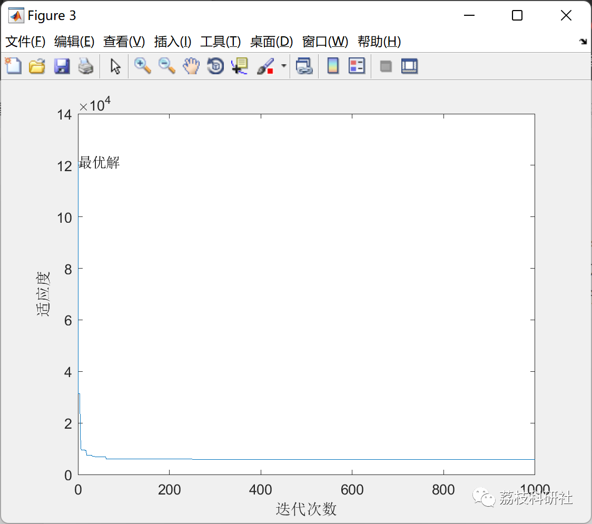

# [Improving Particle Swarm Optimization Algorithm] Hawk-like Particle Swarm ES-PSO Optimization Algorithm (Matlab Code Implementation)

💥💥💞💞 Welcome to this blog❤️❤️ 💥💥
🏆 Bloggers' Advantages: 🌞🌞🌞 The content of the blog strives for rigorous thinking and clear logic to facilitate readers.
⛳️ Mantra: "A journey of a thousand miles begins with a single step."
Litchi Research Society
Code Collection: Power Systems, Intelligent Algorithms and Applications, Neural Network Prediction, Path Planning, Optimized Scheduling, Workshop Scheduling, Image Processing, Signal Processing...
🎁 Special Section Links:
🌈🌈🌈🌟🌟🌟 Electrical Code Intelligent Algorithms and Their Applications Path Planning Neural Network Prediction Optimized Scheduling Image Processing Workshop Scheduling Signal Processing Romantic Her
💥1 Overview
Eagle Strategy (ES) is a two-stage process developed by Yang et al., inspired by the hunting behavior of eagles. It uses different algorithms for global and local searches. ES is a two-stage method. Here, ES has been improved upon the Particel Swarm Optimization (PSO) algorithm. This approach is used in some design problems; welded beam design, tension/compression, pressure vessel, cantilever beam design.
📚2 Run Results
🎉3 References
[1] Hamza YAPICI (2022). PSO_Eagle for design problem .
🌈4 MATLAB Code Implementation
Click the article below left bottom [Read More]

## Images

<!-- PAYMENT_BLOCK -->

## Get this dataset

- Payment link (Stripe): [Buy now](https://buy.stripe.com/3cs8yP7sY87d0vu9AB)
- Payment QR code: 

<!-- /PAYMENT_BLOCK -->
